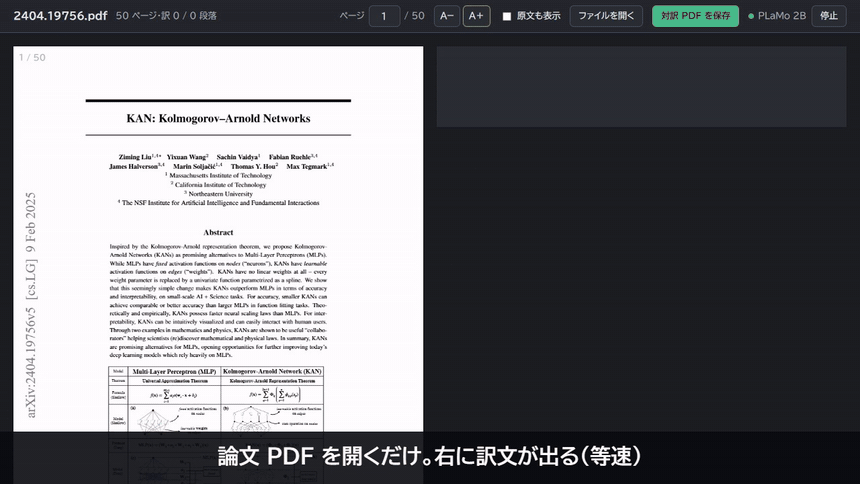
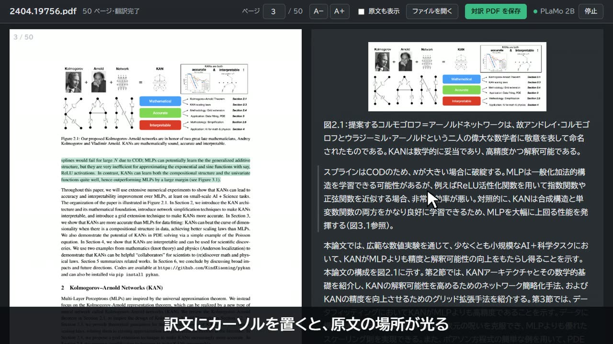
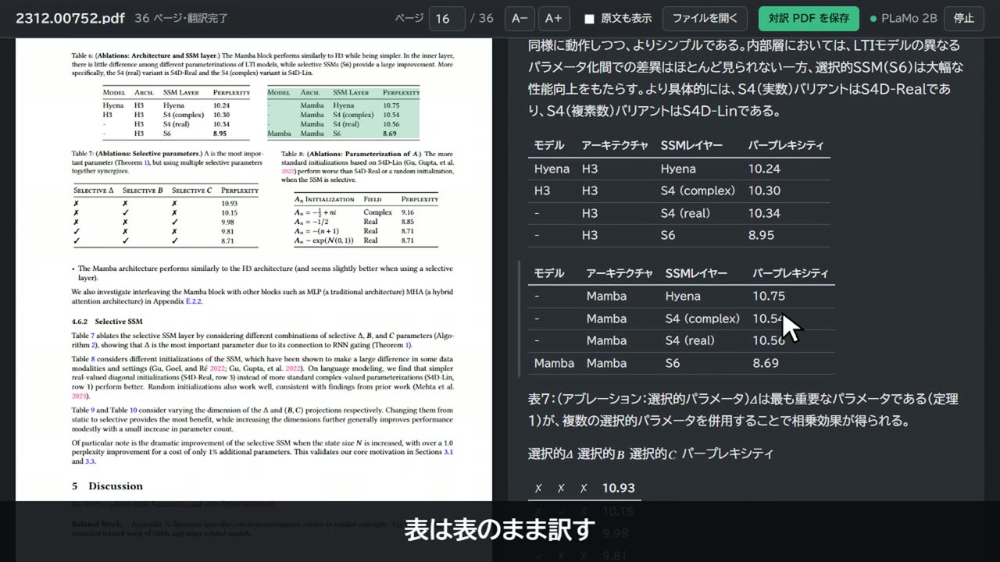
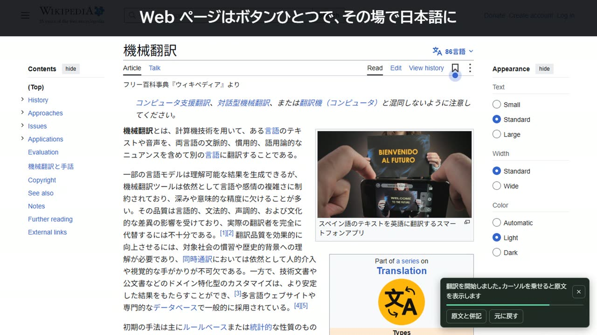

# PLaMo Translate（ローカル翻訳の拡張機能）



自分の PC で動かす [PLaMo 3 Translate](https://huggingface.co/collections/pfnet/plamo-3-translate)（llama.cpp の llama-server）で、Web ページと PDF を翻訳する拡張機能。Chromium 系ブラウザ（Vivaldi・Chrome・Edge）で動く。翻訳はすべて手元で行い、文章は外に出ない。

英語の論文 PDF を読むことを主な目的にしている。ビューアは左に元のページ、右に訳文を並べ、数式・表・図を崩さずに訳す。対訳を印刷して PDF に保存することもできる。

| 原文の場所が分かる | 表は表のまま | Web ページもその場で |
|---|---|---|
|  |  |  |

<sub>画面の論文: Liu et al.「KAN」arXiv:2404.19756、Gu & Dao「Mamba」arXiv:2312.00752（どちらも CC BY 4.0）。Web ページ: Wikipedia「Machine translation」（CC BY-SA 4.0）。</sub>

> Preferred Networks の公式ツールではない。モデルの利用条件は各モデルのページ（PLaMo コミュニティライセンス）に従う。

## エージェントに任せる

Claude Code や Codex などのコーディングエージェントに、このリポジトリの URL を渡して「使えるようにして」と頼むだけで準備が進む。エージェントは [SETUP.md](SETUP.md) に従って進める。人の操作が要るのは、最後にブラウザへ読み込むところだけ。

## ブラウザだけで使う（内蔵の 0.8B）

llama-server や Python を入れずに、拡張機能を読み込むだけで使える。0.8B のモデルをブラウザの中（WebAssembly）で動かす。ノート PC 向け。

1. 拡張機能をブラウザに読み込む（下の「準備」の手順 4 と同じ）
2. 何かのページで翻訳ボタンを押す。初回だけモデル（約 0.57 GB）を Hugging Face から取得してブラウザに保存する。ボタンに進み具合（%）が出る。2 回目からはすぐ読み込まれる

中継プログラムを登録していない PC では、設定の「翻訳エンジン」が既定（自動）のまま内蔵エンジンになる。サーバーも入れてある PC で内蔵エンジンを使うときは、設定で「ブラウザに内蔵の 0.8B」を選ぶ。エンジンの選択はブラウザの同期に乗らず、PC ごとに決まる。

計算は既定で CPU を使う。Ryzen AI 5 340（内蔵 GPU は Radeon 840M）のノート PC で、長めの英文1文の翻訳が CPU で約 1.4 秒、WebGPU で約 3.9 秒だった（4 文を続けて訳すと CPU 3.9 秒、WebGPU の 4 本同時は 5.2 秒）。単体 GPU なら設定で WebGPU を試す価値がある。

## 動く環境（llama-server を使うとき）

| 項目 | 必要なもの |
|---|---|
| OS | Windows 10 / 11（サーバーの起動・停止に PowerShell を使う） |
| GPU | NVIDIA などの GPU。CPU だけでも動くが遅い |
| llama.cpp | [llama.cpp](https://github.com/ggml-org/llama.cpp/releases) **b11946 以降**の `llama-server.exe`（それより古いと PLaMo 3 の tokenizer を読めない） |
| Python | Python 3（拡張機能からサーバーを起動・停止する中継プログラムに使う。標準ライブラリだけで動く） |

RTX 5070 Ti・Q4_K_M での目安は次のとおり。訳の質の差は小さく、普段は 2B で足りる。

| モデル | VRAM | 1文の翻訳 | 生成の速さ |
|---|---|---|---|
| 2B | 約 2.4 GB | 0.06 秒 | 276 tok/s |
| 8B | 約 4.4 GB | 0.10 秒 | 124 tok/s |

## 準備

細かい手順（llama.cpp の選び方・確かめ方・困ったとき）は [SETUP.md](SETUP.md) にある。揃ったかどうかは `server\check.ps1` で確かめられる（最後に `READY` と出れば使える）。

1. **モデルを落とす**

   Hugging Face の [0.8B](https://huggingface.co/pfnet/plamo-3-translate-0.8b-GGUF)・[2B](https://huggingface.co/pfnet/plamo-3-translate-2b-GGUF)・[8B](https://huggingface.co/pfnet/plamo-3-translate-8b-GGUF)・[31B](https://huggingface.co/pfnet/plamo-3-translate-31b-GGUF) のうち、使うものの `plamo-3-translate-<サイズ>-Q4_K_M.gguf` を1つのフォルダに置く。自動起動の既定は 2B。

2. **サーバーの設定を書く**

   `server\config.example.json` を `server\config.json` に写して、次の項目を書き換える。

   - `llamaServer`: llama-server.exe の場所
   - `modelDir`: モデルのフォルダ
   - `logDir`: 空にすると `server\logs\` にログが出る

3. **中継プログラムを登録する**（PC ごとに1回。管理者権限は要らない）

   ```powershell
   powershell -ExecutionPolicy Bypass -File host\install.ps1
   ```

   PATH の Python を見つけて `host\host.bat` を書き、HKCU の Chrome・Chromium・Vivaldi・Edge の `NativeMessagingHosts\com.plamo.translate_host` に登録する。Python が見つからないときは `-Python C:\path\to\python.exe` を付ける。拡張機能の ID は manifest の `key` で `legfpcfpmfannnifaiobenldancdgbdf` に固定してある。

4. **ブラウザに読み込む**

   - 拡張機能のページ（`vivaldi://extensions`・`chrome://extensions`・`edge://extensions`）を開き、「デベロッパーモード」をオンにする
   - 「パッケージ化されていない拡張機能を読み込む」で、このフォルダを選ぶ
   - ローカルの PDF も開くなら、拡張機能の「詳細」で「ファイルの URL へのアクセスを許可する」をオンにする

サーバーを手で動かすときは `server\start-plamo.ps1 [-Size 0.8b|2b|8b|31b]`・`server\stop-plamo.ps1` を使う。port は 11437。

## 使い方

| 操作 | 動き |
|---|---|
| ツールバーのボタン / Alt+Shift+T | Web ページを翻訳する。もう一度押すと元に戻る。翻訳中のタブはボタンに「訳」と出る |
| 文を選んで右クリック →「選択した文を翻訳」/ Alt+Shift+Y | 選んだ文だけ訳して、その近くに出す。日本語の文は英語に、それ以外は日本語に訳す |
| 同じ操作を PDF のタブで | 翻訳ビューアで開き直す（左に元のページ、右に訳文） |
| リンクを右クリック →「リンク先の PDF を翻訳ビューアで開く」 | PDF を開かずにビューアへ |
| ボタンを右クリック →「PDF 翻訳ビューアを開く」 | ダウンロード済みの PDF をドロップして読む |
| ボタンを右クリック →「翻訳サーバーを起動」→ サイズ | サーバーを起動する。別のサイズが動いていたら入れ替える。ボタンにサイズが出る |
| ボタンを右クリック →「翻訳サーバーを止める」、またはビューア右上の「停止」 | VRAM を空ける（ビューアの「停止」は翻訳中は押せない） |

- 翻訳するときにサーバーが止まっていれば、自動で起動する（設定の「自動で起動するモデル」、既定は 2B。起動に約6秒）
- 論文の著者欄（タイトルと Abstract の間）と参考文献は翻訳せず、原文のまま表示する
- 拡張機能が起動したサーバーは、30 分使わなければ自動で止まる（設定で変えられる。手で起動したサーバーは止めない）

### Web ページ

元の文を訳文に置き換える。リンク・太字・コードの位置は残る。原文はカーソルを乗せると出る（Esc やスクロールで消える。文字は選択してコピーできる）。右下のパネルか設定で「原文の下に訳文を足す」表示に切り替えられる。

右下のパネルに進み具合が出る。訳し終わると小さくなり、カーソルを乗せるかクリックすると操作が出る。訳せなかった段落はパネルからやり直せる。サーバーが止まったときは残りを待たせ、「サーバーを起動して再開」で続きから訳す。

画面に近い段落から順に訳し、スクロールした先は近づいたときに訳す。後から読み込まれた段落（無限スクロールなど）も訳す。日本語の段落、コードブロック、入力欄、メニューの短い語は訳さない。表のセルやリストの短い語は、ページの題名と周りの文を文脈として渡して訳す。

### PDF ビューア

見ているページを先に、残りのページも裏で順に訳しておく（15 ページの論文で 2B なら 1 分弱）。

| したいこと | 操作 |
|---|---|
| 原文を見る | 段落をクリックすると原文が出る。上の「原文も表示」で全部出せる（文字を選択しただけでは開かない） |
| 訳文と原文の対応を見る | 訳文の段落にカーソルを乗せると、左のページの該当箇所に色が付く。左のページの段落に乗せると対応する訳文に色が付き、クリックするとその訳文まで移動する |
| ページを移動する | 上のバーでページ番号を入れる。読んでいるページは URL の `#page=N` に入るので、再読み込みしても同じページに戻る |
| 訳文の文字の大きさを変える | 「A−」「A＋」で変えられる（13〜22px） |
| 訳せなかった段落をやり直す | 段落に出る「もう一度試す」を押す。上のバーからまとめてやり直せる |
| 止まっているサーバーを起動する | 上のバーの「起動」で立ち上げ、失敗した段落を訳し直す |

#### 対訳 PDF を保存

全ページの訳が終わるのを待って、A4 横1枚に「左に元のページ・右に訳文」を並べた印刷画面を開く。送り先で「PDF に保存」を選ぶと保存できる（ファイル名は「元の名前（対訳）」）。「原文も表示」をオンにしておくと原文も一緒に入る。

訳文が長いページは文字を 9pt から 6pt まで縮めて1枚に収め、それでも入らないページは次の紙へ続く（2段組で字の詰まった論文は半分ほどのページがはみ出す）。

#### 数式

PDF の文字の位置・フォント・罫線から MathML に組み直して訳文に入れる（添字・分数・根号・総和の上下・アクセント・複数行の式）。文字として選択でき、文字サイズの変更や暗いテーマにも追従する。段落や式をクリックすると元のページの画像が出るので照合できる。

<details>
<summary>数式の見分け方と、組み直せないとき</summary>

TeX の数式フォントを使う PDF が対象で、配置を説明できない文字が1つでもある式は、組み直さず画像のままにする（設定で常に画像にもできる）。画像にするときは、元のページを高い解像度で描いて切り抜いて入れる（文中の式は文の中に、独立した式は段落の間に）。

数式は数式用のフォント（CMMI・CMSY・CMEX など）と、そのページの本文と違うローマン体（CMR など）で見分ける。文中の式は `<t1>…</t1>` の印を付けてモデルに送り、訳文の中で同じ位置に戻す。

</details>

#### 図

図（グラフ・構成図・写真）は元のページから色付きで切り抜いて入れ、図の中の文字（軸の数字・ラベル・斜めの文字）は訳さない。図は元のページと同じ縮尺で表示し、同じ段で高さの重なる図（横に並んだ図）は元の配置のまま並べる。

2段組のページでは、訳文は「左の段 → 右の段」の読む順に1段で並び、図はその段の中で図の題の直前に入る（両段にまたがる図は高さの順）。

<details>
<summary>図の範囲の求め方</summary>

図の範囲は PDF の描画命令（線・塗り・画像）から求める。罫線や矢印のような細い線はほかの描画をつなぐだけに使い、近い描画をまとめ、その中や周りの短い文字を図に含める。長い文の行を囲んだ枠（アルゴリズムの枠など）は図にしない。

</details>

#### 表

HTML の表に組み直す。セルはまとめて1回で訳し、直前の段落（表の題）を文脈に渡す。表をクリックすると元の表の画像が出る。列が16を超えるか、ほとんど空の表は組み直さずに画像で見せる。

<details>
<summary>表の見分け方</summary>

大きな隙間（文字の高さの1.5倍）で区切られた行、または数値のセルが2つ以上ある詰まった行（0.6倍）が2行以上続く範囲を表とみなす。列は「ほとんどの行で空いている位置」で分ける（2列にまたがる値や段の見出しがあっても列が崩れにくい）。

</details>

## ファイルの役割

<details>
<summary>一覧を開く</summary>

| ファイル | 役割 |
|---|---|
| `background.js` | 翻訳の依頼（サーバーは同時4本・キャッシュ、内蔵エンジンは `engine.html` へ）、ボタンと右クリックメニュー |
| `engine.html` / `engine.js` | 内蔵エンジン。offscreen document で wllama を動かし、0.8B のモデルを OPFS に保存する。PFML3 のプロンプトを自前で組む |
| `vendor/wllama` | wllama（llama.cpp の WebAssembly + WebGPU 版）のビルド済みファイル。作り直しは `node tools/wllama/build.mjs`（Docker が要る。手順とパッチは [Sakutto](https://github.com/jammaru/sakutto) に倣った。`tools/wllama/NOTICE`） |
| `tools/serve.mjs` | 内蔵エンジンを拡張機能なしで試すための http サーバー（wasm のスレッドに要るヘッダーを付ける） |
| `shared.js` | 訳す文の判定と翻訳の依頼（ページとビューアで共用） |
| `content.js` / `content.css` | Web ページの翻訳（置き換え・併記） |
| `mathml.js` | PDF の文字の配置から数式を MathML に組み直す |
| `viewer.*` / `pdftext.js` | PDF 翻訳ビューア。`pdftext.js` は PDF の文字と描画命令を段落・数式・表・図に分け、`viewer.js` は描画と翻訳の受け渡しをする。PDF の描画は `vendor/pdfjs`（pdfjs-dist 5.7.284、Apache-2.0） |
| `options.*` | 設定（サーバーの URL、訳す先の言語、表示の仕方、自動起動・自動停止） |
| `host/` | 中継プログラム（`host.py`）と登録スクリプト `install.ps1` |
| `server/` | llama-server の起動・停止スクリプト、設定の例、使える状態かの点検（`check.ps1`） |
| `SETUP.md` | 新しい PC で使える状態にする手順 |
| `test/` | 動作確認用のページと解析ツール（下記） |
| `AGENTS.md` / `CLAUDE.md` | コーディングエージェント（Codex・Claude Code など）に環境構築を頼むときの手順。`CLAUDE.md` は `AGENTS.md` を読み込むだけ |

</details>

## 動作確認

<details>
<summary>手順を開く</summary>

論文 PDF はリポジトリに入れていない。`test\fetch-papers.ps1` で arXiv から6本（Attention・BERT・ResNet・Adam・VAE・DDPM）を落とせる。

次のコマンドをこのフォルダで動かすと、拡張機能なしでサーバーに直接つないで試せる。

```powershell
python -m http.server 8765 --bind 127.0.0.1
```

| URL | 試せること |
|---|---|
| `http://127.0.0.1:8765/viewer.html?file=/test/sample.pdf` | PDF ビューア |
| `http://127.0.0.1:8765/test/page.html` | Web ページの翻訳 |
| `http://127.0.0.1:8765/test/analyze.html?files=papers/1810.04805.pdf` | 全ページの分け方（段落・式・表・図）と怪しい箇所の一覧 |
| `http://127.0.0.1:8765/test/math.html?files=papers/2006.11239.pdf&kind=eq` | 元の式の画像と組み直した MathML の並べ比べ（`only=fail` で画像に戻した式の理由だけ） |

内蔵エンジンは `node tools/serve.mjs` で開き、`http://127.0.0.1:8765/test/engine.html` で4文を訳して時間を測れる（`?device=webgpu` で WebGPU）。このページはブラウザの保存領域が足りないとモデルをメモリに置くので、開くたびに取得し直す。

</details>

## 制限

中継プログラムが未登録だと自動起動できず、右下に案内が出る。ボタンにマウスを乗せると失敗の理由が出る。Python の場所を変えたら `host\install.ps1` をもう一度実行する。

ショートカットが効かないときは、ブラウザ側の割り当てと重なっている（Chromium の Alt+Shift+T など）。拡張機能のキーボードショートカットの設定（`chrome://extensions/shortcuts` など）で別のキーを割り当てる。

Web ページの置き換え表示は、ページのスクリプトがその段落を書き換えると元に戻らないことがある（再読み込みで戻る）。

PDF ビューアは文字を取り出して段落に組み直すので、次の制限がある。

| 対象 | 起こること |
|---|---|
| 図の中の文字 | 崩れることがある |
| 罫線で区切っただけの隙間の狭い表、セルの中で改行の多い表 | 列がずれることがある（表をクリックすれば元の画像で確かめられる） |
| 数式の切り抜き | 隣の行の文字のかけらが写ることがある |
| Word などで作った PDF の数式（Cambria Math 以外の普通のフォントで書かれたもの） | 見分けられない |
| スキャンした画像だけの PDF | 文字がなくて訳せない |

## ライセンス

MIT（`LICENSE`）。`vendor/pdfjs` は pdf.js（Apache License 2.0）。`vendor/wllama` は wllama・llama.cpp・Emscripten のランタイム（MIT）と Dawn（BSD-3-Clause）。`tools/wllama/` のビルド手順とパッチは Sakutto（MIT）から（`tools/wllama/NOTICE`）。
